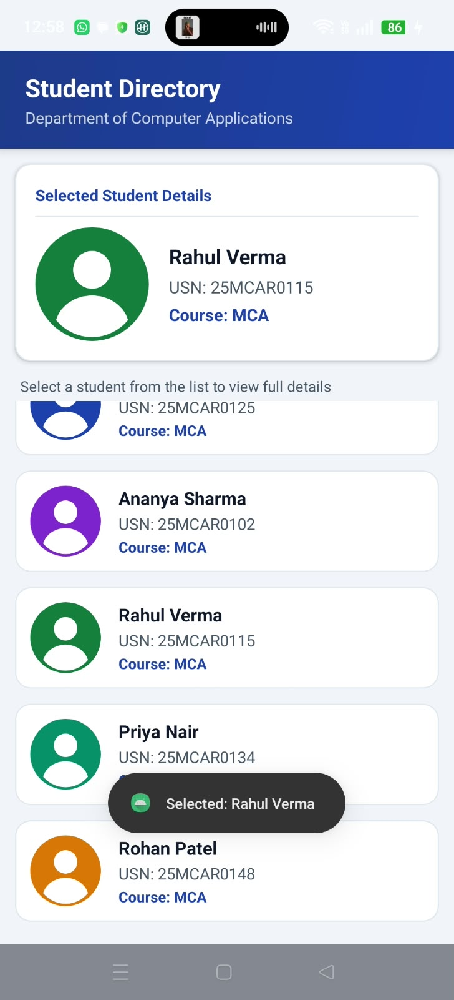
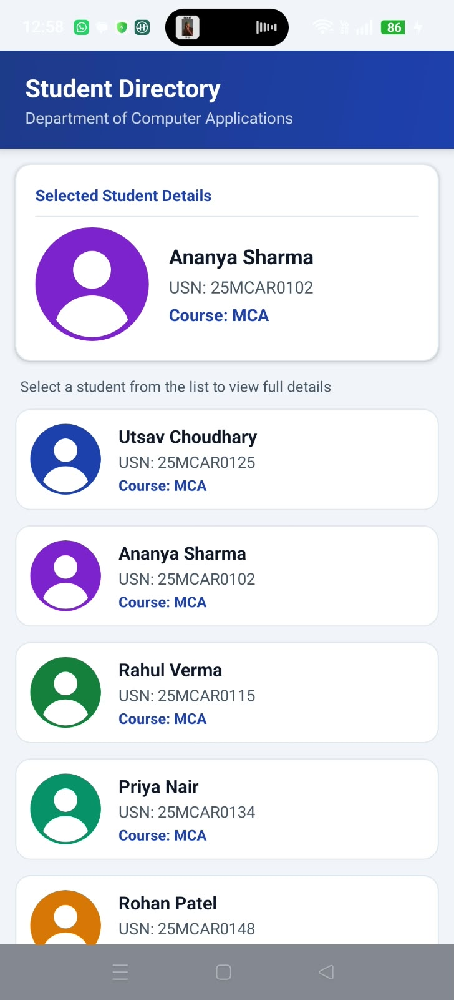
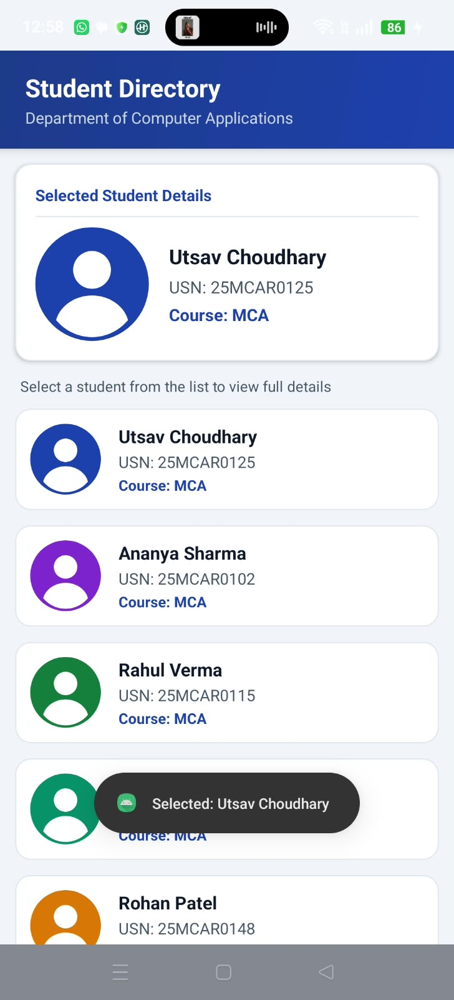

# AdaptiveStudentList

**GitHub Repository:** [https://github.com/UtsavChoudhary25/AdaptiveStudentList](https://github.com/UtsavChoudhary25/AdaptiveStudentList)

## 1. Project Title
**Adaptive Student List Application**

## 2. Project Overview
`AdaptiveStudentList` is an Android application developed in Kotlin using traditional Android Views. It demonstrates the practical implementation of `ListView` with a custom `BaseAdapter` and `ImageView` for displaying dynamic profile images. The application adopts an adaptive, responsive UI design that seamlessly adjusts across different screen orientations (Portrait and Landscape) and device resolutions.

## 3. Objective
- To implement a custom `ListView` adapter (`StudentAdapter`) in Kotlin using traditional Android Views.
- To demonstrate loading local vector drawables into `ImageView` components efficiently.
- To design an adaptive UI layout capable of dynamically adjusting between portrait and landscape modes.
- To handle user click events on list items, updating a detailed preview panel and displaying feedback Toast notifications.

## 4. Concept / Technology Behind the Application
The application is built on core Android Views principles:
- **`ListView` & Adapter Pattern:** Efficiently renders scrolling lists of student data by binding data items to row layouts (`student_item.xml`). The adapter reuses view references via the `ViewHolder` design pattern.
- **`ImageView` rendering:** Displays student profile pictures from local vector drawables with `scaleType="fitCenter"` to preserve aspect ratio across screen sizes.
- **Adaptive UI Architecture:** Utilizes XML resource qualifiers (`layout` for portrait and `layout-land` for landscape) alongside `LinearLayout` and `ConstraintLayout` to dynamically re-arrange content for optimal screen utilization.

## 5. Scenario Used
A college Mobile Application Development (MAD) lab scenario where a Department Student Directory needs to display student records. Selecting any student from the directory updates a prominent "Selected Student Details" panel showing the profile image, full name, USN, and course name, accompanied by a Toast confirmation message.

## 6. Features
- **Adaptive Orientation Support:** Dual layout setup (`activity_main.xml` for portrait, `layout-land/activity_main.xml` for landscape).
- **Custom ListView Rows:** Custom layout (`student_item.xml`) displaying profile picture, name, USN, and course.
- **Interactive Detail Panel:** Selecting a list item dynamically populates the details card and triggers a Toast notification.
- **Pre-populated Student Records:** Displays realistic MCA student profiles, including primary record Utsav Choudhary (USN: 25MCAR0125).
- **Clean Architecture & Accessibility:** Proper DP/SP units, vector drawables, accessible content descriptions, and localized strings.

## 7. Technologies Used
- **Language:** Kotlin
- **UI Paradigm:** Android XML Views (ConstraintLayout, LinearLayout, ListView, ImageView)
- **Minimum SDK:** API Level 24 (Android 7.0 Nougat)
- **Target SDK:** API Level 37
- **Build System:** Gradle (Kotlin DSL)
- **IDE:** Android Studio

## 8. How ListView Works in this Project
1. **Data source:** A list of `Student` data objects defined in `MainActivity.kt`.
2. **Adapter (`StudentAdapter`):** Inherits from `BaseAdapter`. Overrides `getView()` to inflate `student_item.xml`.
3. **ViewHolder Pattern:** Caches references to `imgStudentProfile`, `tvStudentName`, `tvStudentUsn`, and `tvStudentCourse` to eliminate unnecessary calls to `findViewById()`.
4. **Item Clicks:** `lvStudents.onItemClickListener` listens for user taps and invokes `displayStudentDetails()` with the clicked `Student` object.

## 9. How ImageView Works in this Project
1. **Local Drawables:** Scalable vector drawables (`ic_student_1.xml` to `ic_student_5.xml`) are stored in `res/drawable/`.
2. **Profile & Detail Binding:** `imgStudentProfile` in list items and `imgDetailProfile` in the detail section call `setImageResource(student.imageResId)`.
3. **Scale & Accessibility:** Set to `scaleType="fitCenter"` to prevent distortion, with dynamic content descriptions set for screen readers.

## 10. Adaptive UI Explanation
- **Portrait Mode (`res/layout/activity_main.xml`):** Arranges the app header, Selected Student Details panel, and Student Directory ListView vertically.
- **Landscape Mode (`res/layout-land/activity_main.xml`):** Divides the screen horizontally into two equal panes — ListView on the left and the Selected Student Details card on the right.
- **Dimensions & Text Units:** All spacing and sizes use `dp` for margins/paddings and `sp` for typography to ensure responsiveness across different screen densities.

## 11. Project Folder / File Structure
```
app/
 └── src/
     └── main/
         ├── java/com/example/adaptivestudentlist/
         │   ├── MainActivity.kt
         │   ├── Student.kt
         │   └── StudentAdapter.kt
         ├── res/
         │   ├── drawable/
         │   │   ├── bg_card_rounded.xml
         │   │   ├── bg_header.xml
         │   │   ├── bg_badge.xml
         │   │   ├── ic_student_1.xml
         │   │   ├── ic_student_2.xml
         │   │   ├── ic_student_3.xml
         │   │   ├── ic_student_4.xml
         │   │   └── ic_student_5.xml
         │   ├── layout/
         │   │   ├── activity_main.xml
         │   │   └── student_item.xml
         │   ├── layout-land/
         │   │   └── activity_main.xml
         │   ├── values/
         │   │   ├── colors.xml
         │   │   ├── strings.xml
         │   │   └── themes.xml
         │   └── values-night/
         │       └── themes.xml
         └── AndroidManifest.xml
screenshots/
 ├── test_case_1.jpeg
 ├── test_case_2.jpeg
 └── test_case_3.jpeg
```

## 12. How to Run the Application
1. Open Android Studio.
2. Select **File > Open** and navigate to `AdaptiveStudentList`.
3. Allow Gradle to sync project dependencies.
4. Select an Android Emulator or connected physical device (API 24+).
5. Click **Run > Run 'app'** (or press `Shift + F10`).

## 13. Test Cases

### TC01
- **Test Case ID:** TC01
- **Description:** Verify that the application launches and displays the Student Directory with the ListView.
- **Steps:**
  1. Launch the `AdaptiveStudentList` app on emulator or physical device.
  2. Observe the main screen layout.
- **Expected Result:** The application launches successfully without crashing. The "Student Directory" header and the scrollable `ListView` containing student records are visible.
- **Actual Result:** Passed. Application launches cleanly displaying the directory list and detail preview section.
- **Screenshot:**  
  

---

### TC02
- **Test Case ID:** TC02
- **Description:** Verify that selecting a student updates the student details and ImageView.
- **Steps:**
  1. Launch the application.
  2. Tap on any student item in the `ListView` (e.g., Ananya Sharma or Rahul Verma).
  3. Observe the "Selected Student Details" panel at the top (portrait) or right (landscape).
- **Expected Result:** The detail panel updates instantly with the selected student's profile picture, Name, USN, and Course. A Toast notification confirming the selection appears at the bottom.
- **Actual Result:** Passed. Selecting Rahul Verma updates the detail section image/text and displays `"Selected: Rahul Verma"` Toast message.
- **Screenshot:**  
  

---

### TC03
- **Test Case ID:** TC03
- **Description:** Verify that selecting Utsav Choudhary displays:
  - **Name:** Utsav Choudhary
  - **USN:** 25MCAR0125
  - **Course:** MCA
- **Steps:**
  1. Launch the application.
  2. Tap on "Utsav Choudhary" in the student directory `ListView`.
  3. Inspect the "Selected Student Details" section.
- **Expected Result:** Detail panel accurately displays:
  - **Name:** Utsav Choudhary
  - **USN:** 25MCAR0125
  - **Course:** MCA
  - Profile Image matching Utsav Choudhary's avatar drawable.
  - Toast displayed: `"Selected: Utsav Choudhary"`.
- **Actual Result:** Passed. Detail panel accurately displays Name: Utsav Choudhary, USN: 25MCAR0125, Course: MCA, and shows `"Selected: Utsav Choudhary"` Toast message.
- **Screenshot:**  
  

## 14. Expected Results
- **Seamless Scrolling:** Smooth scrolling across all student rows without UI lag or memory leaks.
- **Accurate Selection:** Clicking any row immediately refreshes the detail section and displays the corresponding Toast message.
- **Orientation Responsiveness:** Rotating the device smoothly adapts the layout between single-column (portrait) and two-pane side-by-side (landscape).

## 15. Screenshots
All test screenshots are stored in the `./screenshots/` directory:
- **Test Case 1:** `./screenshots/test_case_1.jpeg`
- **Test Case 2:** `./screenshots/test_case_2.jpeg` (Utsav Choudhary selected)
- **Test Case 3:** `./screenshots/test_case_3.jpeg` (Rahul Verma selected)

## 16. Result / Conclusion
The `AdaptiveStudentList` application successfully satisfies all requirements. It demonstrates the effective use of traditional Android Views (`ListView` and `ImageView`), custom adapters (`StudentAdapter`), adaptive resource qualifiers, and clean event handling.
